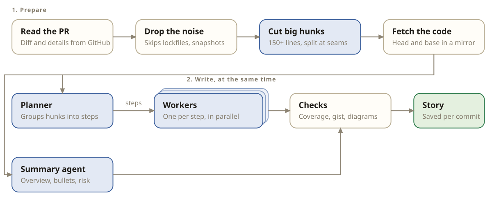

# PR Explainer

Read a pull request in the order it makes sense, with a short orientation for each step, before you read the code.

## Why it exists

A diff shows files in alphabetical order. A reviewer needs the story first: what the change is for, how the pieces fit, and where the decisions are. Most of the time goes into rebuilding that story in your head.

PR Explainer builds it for you:

- It groups the changes into steps, in the order you should read them.
- Each step gets a short gist of what that part does, so you know what you are about to read.
- Where a step branches, it draws the control flow. It never draws diagrams of how code is organised.
- It does not retell the diff, and it does not hunt for bugs. Your CI and your own eyes do that. You still read the code.

## See it in action

**PR walkthrough.**

Follow [budget-bot #1](https://github.com/Oluwa-nifemi/budget-bot/pull/1) from the overview through the review steps, diagrams and comments.

https://github.com/user-attachments/assets/f798ded0-5c45-43e8-a12b-6b1d76d108b2

**Generation.**

From pasting a PR link to the finished walkthrough. This recording is sped up 3×.

https://github.com/user-attachments/assets/8ea76f7c-e585-44c9-b204-d5f8ab325938

**Settings.**

Edit the worker prompt, choose how many diagrams you want, and change file rules.

https://github.com/user-attachments/assets/550eb711-e193-4f28-9151-b25ca50ac077

## How it works



Blue boxes are model calls. The rest is plain code. The planner streams its steps, so a worker starts on each step as soon as it arrives. A worker sees only its own step, plus code context that was read by code and not by the model: the old version of changed functions, callers of changed names, and the functions they call. After the models answer, code checks the result. Every hunk must be in exactly one step, gists and diagrams must follow the rules, and anything that breaks them is fixed once or dropped.

## Quick start

You need Docker, a GitHub token, and one provider that writes the stories: a [LiteLLM](https://github.com/BerriAI/litellm) gateway, or Claude Code signed in on the same machine.

1. Clone the repo:

   ```sh
   git clone https://github.com/Oluwa-nifemi/pr-explainer.git
   cd pr-explainer
   ```

2. Start it:

   ```sh
   ./start.sh
   ```

   It starts the Claude Code bridge when Claude Code is signed in, then the containers. `--no-build` skips the rebuild, `--stop` stops both, `--install-service` starts the bridge at login. `docker compose up -d --build` still works on its own.

3. Open http://127.0.0.1:5180 and fill in the setup screen. Enter your GitHub token, then pick a provider: your Claude Code login needs nothing else, and a LiteLLM gateway needs its URL and key. Choose the model, press Save, and paste a PR link.

No `.env` file is needed. Copy `.env.example` to `.env` only to change something the setup screen does not cover, such as the gateway model ids or the org the watcher searches, or to set one value for every machine. The table under [Configuration](#configuration) lists what each variable does.

The containers restart by themselves when Docker starts. Turn on "Start Docker Desktop when you sign in" and nothing else is needed.

<details>
<summary>Run without Docker</summary>

```sh
cd service && npm start     # port 5190
cd app && npm install && npm run dev   # port 5180
```

Needs Node 22 and git. Stop the containers first, they use the same ports.

Export reads the page built by `npm run build:export --prefix app`. Run that once, or it answers with a 500.

</details>

### What to connect

**GitHub token.** It must read the repos you review and write reviews. A classic token with `repo` works. A fine-grained token needs Pull requests (read and write) and Contents (read).

**LiteLLM gateway.** The service calls `/chat/completions` on your gateway. Pick this when you already have a gateway with the models you want.

**Claude Code instead.** You can write stories and chat with a Claude Code login instead of a gateway. `./start.sh` starts the bridge on your machine; then pick Claude Code in Settings → Connections or on the setup screen.

Stories and chat both go through the bridge. See [docs/bridge.md](docs/bridge.md) for how it works and how to keep it running at login.

## Features

- Stories and chat written by your LiteLLM gateway, or by your Claude Code login through a bridge
- A PR split into review steps, each with a short gist
- Flow diagrams for steps that branch
- One-line notes on test hunks. Tests and docs sit in a closing section
- Comments on lines and ranges, thread replies and reactions
- Drafts you keep until you post everything as one review
- Chat grounded in the repo, which can also read the PR description and your drafts when you ask
- Stories marked Outdated when prompts change, and Regenerate on request
- The model that wrote a story is shown on the overview. Changing the model does not mark saved stories outdated
- Retry for one failed step
- Editable prompts and file rules
- Export one PR as a single HTML file you can send to someone
- Open a PR straight from Raycast, see [docs/raycast.md](docs/raycast.md)

## Settings

Click Settings on the home page. You can read and change:

- **How it works.** The flow above, with the checks that always run.
- **Prompts.** Everything each agent is sent, in order. Edit the planner, summary and worker text, and choose how many diagrams you want.
- **Files.** What is left out of stories, such as lockfiles and snapshots, and how files are labelled as test, config or docs. Add your own patterns and try a path before you save.
- **Connections.** Your GitHub token, and the provider that writes stories: a LiteLLM gateway, or the Claude Code bridge with the model you want. Each one has a Test button and a status line.
- **Diagnostics.** Export recent service logs and this tab's browser errors as one JSON file. It works before setup too.

## Configuration

These live in `.env`, which Docker Compose reads by itself. A row marked as covered by the app is optional here: set it only to pin one value for every machine.

| Variable | Meaning | Also in the app? |
|---|---|---|
| `PR_EXPLAINER_GITHUB_TOKEN` | GitHub token | Yes, Connections |
| `PR_EXPLAINER_LITELLM_API_KEY` | LiteLLM key | Yes, Connections |
| `PR_EXPLAINER_LITELLM_BASE_URL` | Gateway URL, without `/v1` | Yes, Connections |
| `PR_EXPLAINER_STORY_MODEL` | Pins the model that writes stories: `deepseek`, `opus`, `claude` or `claude-sonnet` | Shown locked in Connections, change it here |
| `PR_EXPLAINER_CLAUDE_BASE_URL` | Where the bridge listens. Default `http://host.docker.internal:5191` inside Docker, `http://127.0.0.1:5191` outside it. Only needed when the bridge is not on the machine that runs Docker | No, this file only |
| `PR_EXPLAINER_CLAUDE_MODEL` | Model id behind the Opus Claude Code profile. Default `claude-code-opus` | No, this file only |
| `PR_EXPLAINER_CLAUDE_SONNET_MODEL` | Model id behind the Sonnet Claude Code profile. Default `claude-code-sonnet` | No, this file only |
| `PR_EXPLAINER_FAST_MODEL` | Model id for the fast LiteLLM profile. Default `deepseek-chat` | No, this file only |
| `PR_EXPLAINER_STRONG_MODEL` | Model id for the strong LiteLLM profile. Default `claude-opus-4-5` | No, this file only |
| `PR_EXPLAINER_STRONG_MODEL_BODY` | Optional JSON merged into every request to the strong profile, for example routing tags | No, this file only |
| `PRX_WATCH` | Default for the background watcher. Docker turns it off unless you set this | Yes, Features |
| `PRX_ORG` | Org the watcher searches | No, this file only |
| `PRX_TEAMS` | Default teams for the teammate filter. With neither the page nor this set, the teams you are on are used | Yes, Features |
| `PRX_EXTRA_TEAMMATES`, `PRX_EXCLUDED_TEAMMATES` | Add or remove logins in the teammate list. When set, the watcher only queues their PRs | No, this file only |
| `PRX_IGNORED_REPOS` | Default repos the watcher never queues | Yes, Features |

## When something breaks

- **GitHub.** Reads retry twice on connection failures and HTTP 500, 502, 503 and 504 responses. Timeouts, permission and rate-limit failures are not retried, and writes never are. If a PR still fails to open, press Retry on the error page.
- **A dropped connection is not lost credentials.** Saved stories stay readable, the header names what is unavailable, and the notice clears when the check recovers. Setup appears only for credentials that are missing, rejected or need correcting.
- **Logs.** Settings → Diagnostics → Export logs gives one JSON file with recent service logs and this tab's browser errors. It works before setup from http://127.0.0.1:5180/?settings=diagnostics. Keys and common credential patterns are redacted; repo names, paths and story text may remain, so read it before sharing. Nothing is uploaded.
- **Container logs.** `logs/service.log` in the repo, rotated at 5 MB. Or `docker compose logs service`.

## Privacy and limits

- The diff and some repo context (changed functions, their callers, the old code) go to the provider that writes your stories. On LiteLLM that is your gateway. On Claude Code it is Anthropic, through the `claude` command on your machine. Chat goes to the same provider.
- Your GitHub token goes only to GitHub.
- Tokens are stored on your machine only. The service never returns them.
- The ports listen on `127.0.0.1` only. There is no login, so this is a single-user tool.

## License

MIT. See [LICENSE](LICENSE).
