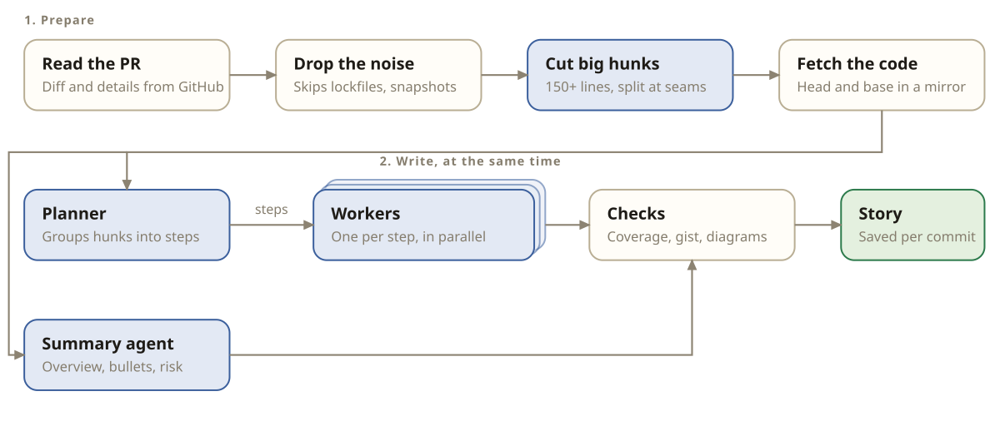

# PR Explainer

Read a pull request in the order it makes sense, with a short orientation for each step, before you read the code.

## Why it exists

A diff shows files in alphabetical order. A reviewer needs the story first: what the change is for, how the pieces fit, and where the decisions are. Most of the time goes into rebuilding that story in your head.

PR Explainer builds it for you:

- It groups the changes into steps, in the order you should read them.
- Each step gets a short gist of what that part does, so you know what you are about to read.
- Where a step branches, it draws the control flow. It never draws diagrams of how code is organised.
- It does not retell the diff, and it does not hunt for bugs. Your CI and your own eyes do that. You still read the code.

## See it in action

**PR walkthrough.**

Follow [budget-bot #1](https://github.com/Oluwa-nifemi/budget-bot/pull/1) from the overview through the review steps, diagrams and comments.

https://github.com/user-attachments/assets/f798ded0-5c45-43e8-a12b-6b1d76d108b2

**Generation.**

From pasting a PR link to the finished walkthrough. This recording is sped up 3×.

https://github.com/user-attachments/assets/8ea76f7c-e585-44c9-b204-d5f8ab325938

**Settings.**

Edit the worker prompt, choose how many diagrams you want, and change file rules.

https://github.com/user-attachments/assets/550eb711-e193-4f28-9151-b25ca50ac077

## How it works



Blue boxes are model calls. The rest is plain code. The planner streams its steps, so a worker starts on each step as soon as it arrives. A worker sees only its own step, plus code context that was read by code and not by the model: the old version of changed functions, callers of changed names, and the functions they call. After the models answer, code checks the result. Every hunk must be in exactly one step, gists and diagrams must follow the rules, and anything that breaks them is fixed once or dropped.

## Quick start

You need Docker, a GitHub token and a [LiteLLM](https://github.com/BerriAI/litellm) gateway.

1. Clone the repo and copy the example settings:

   ```sh
   git clone https://github.com/Oluwa-nifemi/pr-explainer.git
   cd pr-explainer
   cp .env.example .env
   ```

2. Edit `.env`. Set your gateway URL and, if your gateway uses other model names, the model ids. You can also leave the keys empty and enter them on the setup screen.
3. Start it:

   ```sh
   docker compose up -d --build
   ```

4. Open http://127.0.0.1:5180. Enter your GitHub token and LiteLLM key if asked, paste a PR link, and wait a few seconds.

The containers restart by themselves when Docker starts. Turn on "Start Docker Desktop when you sign in" and nothing else is needed.

### Open a PR from Raycast

Add this repo's `raycast/` folder as a Script Directory in Raycast Settings → Extensions → Script Commands. The script must be executable: `chmod +x raycast/explain-pr.sh`.

Search for **Explain PR**, paste a GitHub PR URL into the argument field, and press Enter. It opens that PR in your browser. PR Explainer must already be running locally.

**GitHub token.** It must read the repos you review and write reviews. A classic token with `repo` works. A fine-grained token needs Pull requests (read and write) and Contents (read).

**LiteLLM gateway.** The service calls `/chat/completions` on your gateway. Only LiteLLM is tested.

<details>
<summary>Run without Docker</summary>

```sh
cd service && npm start     # port 5190
cd app && npm install && npm run dev   # port 5180
```

Needs Node 22 and git. Stop the containers first, they use the same ports.

The Export button reads the page built by `npm run build:export --prefix app`. Run that once, or the button answers with a 500.

</details>

## Export a story

Open a PR and click Export in the header. You get one HTML file with the whole story inside it: the overview, every step, the diagrams, the diffs and the test and doc files. Your draft comments are kept too, in that file's own local storage.

The file works with no service behind it. Open it by double-clicking, or send it to someone. Chat, posting a review and the file lines between hunks need the service, so they are off in an export. The exported story is a snapshot: it does not follow new commits.

## Features

- A PR split into review steps, each with a short gist
- Flow diagrams for steps that branch
- One-line notes on test hunks. Tests and docs sit in a closing section
- Comments on lines and ranges, thread replies and reactions
- Drafts you keep until you post everything as one review
- Chat grounded in the repo, which can also read the PR description and your drafts when you ask
- Stories marked Outdated when prompts change, and Regenerate on request
- Retry for one failed step
- Editable prompts and file rules
- Export one PR as a single HTML file you can send to someone

## Configuration

Put these in `.env`. Docker Compose reads the file by itself.

| Variable | Meaning |
|---|---|
| `PR_EXPLAINER_GITHUB_TOKEN` | GitHub token. Optional, you can use the setup screen |
| `PR_EXPLAINER_LITELLM_API_KEY` | LiteLLM key. Optional, you can use the setup screen |
| `PR_EXPLAINER_LITELLM_BASE_URL` | Gateway URL, without `/v1` |
| `PR_EXPLAINER_FAST_MODEL` | Model id for the fast profile. Default `deepseek-chat` |
| `PR_EXPLAINER_STRONG_MODEL` | Model id for the strong profile. Default `claude-opus-4-5` |
| `PR_EXPLAINER_STRONG_MODEL_BODY` | Optional JSON merged into every request to the strong model, for example routing tags |
| `PRX_WATCH` | `1` queues PRs where your review is requested. Off by default |
| `PRX_ORG`, `PRX_TEAMS` | Limit the watcher to one org and its teams |
| `PRX_EXTRA_TEAMMATES`, `PRX_EXCLUDED_TEAMMATES` | Add or remove logins in the teammate list. When set, the watcher only queues their PRs |
| `PRX_IGNORED_REPOS` | Repos the watcher never queues |

### Settings page

Click Settings on the home page. You can read and change:

- **How it works.** The flow above, with the checks that always run.
- **Prompts.** Everything each agent is sent, in order. Edit the planner, summary and worker text, and choose how many diagrams you want.
- **Files.** What is left out of stories, such as lockfiles and snapshots, and how files are labelled as test, config or docs. Add your own patterns and try a path before you save.
- **Connections.** Your GitHub and LiteLLM details.

Your changes are saved to `~/.config/pr-explainer/overrides.json`, outside the project. Anything you do not change follows the defaults. Saving marks existing stories as Outdated, and you regenerate them one at a time. To go back to the defaults, delete the file. In Docker: `docker compose exec service rm /home/node/.config/pr-explainer/overrides.json`.

## Privacy and limits

- The diff and some repo context (changed functions, their callers, the old code) go to your LiteLLM gateway. Your GitHub token goes only to GitHub.
- Tokens are stored on your machine only. The service never returns them.
- The ports listen on `127.0.0.1` only. There is no login, so this is a single-user tool.

## License

MIT. See [LICENSE](LICENSE).
